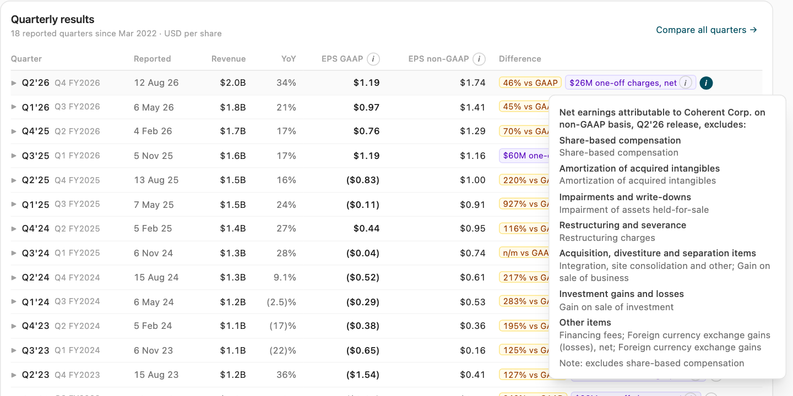
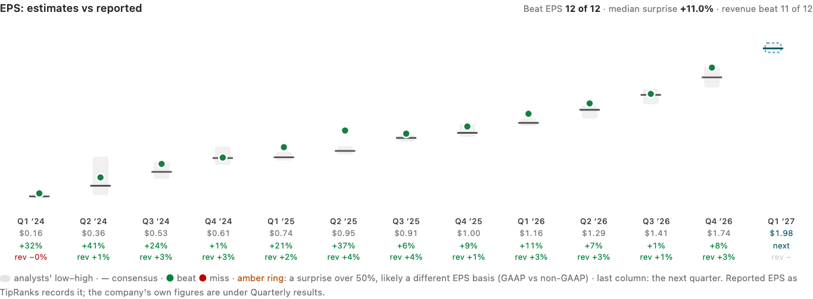
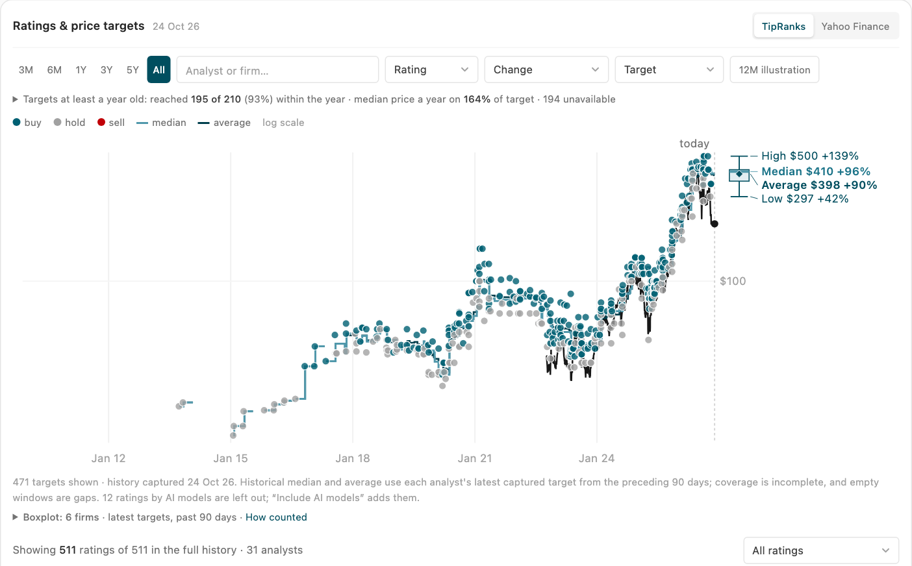
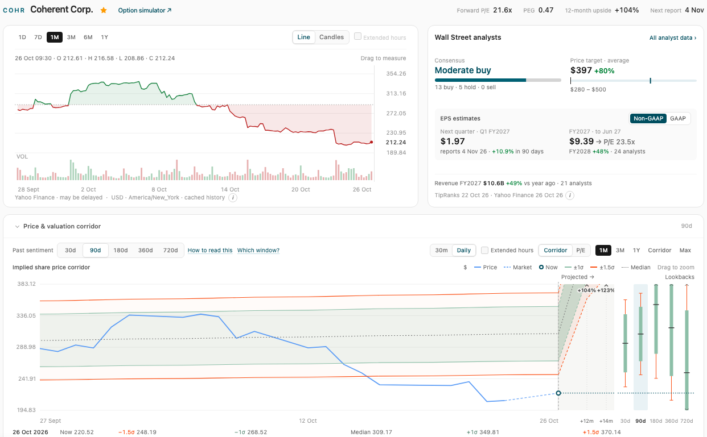
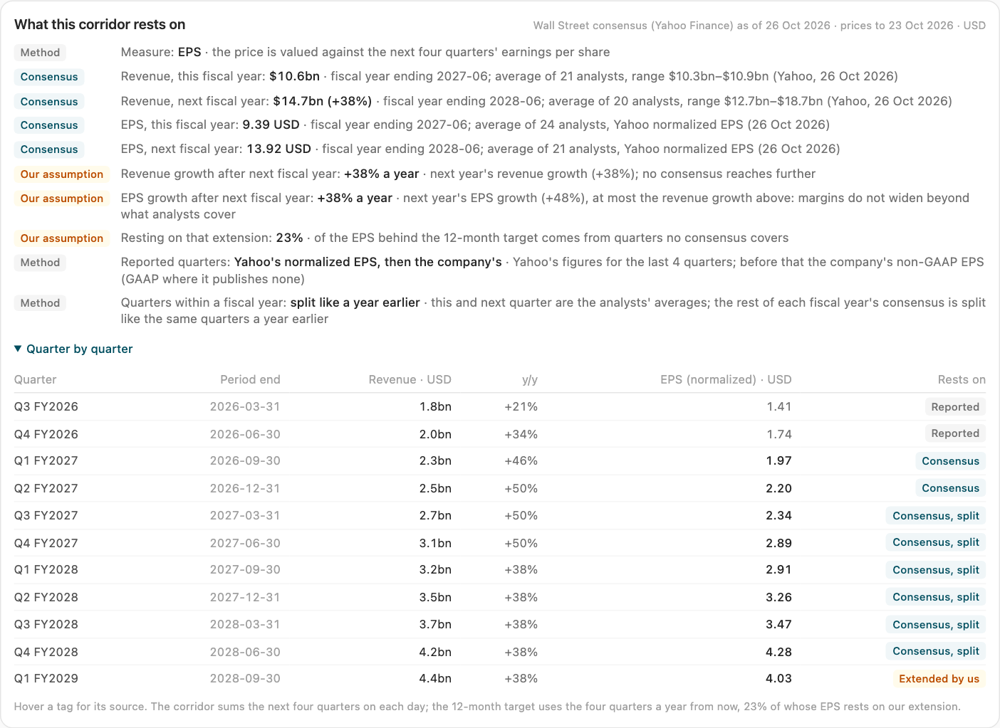
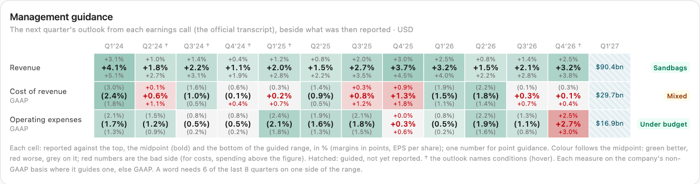
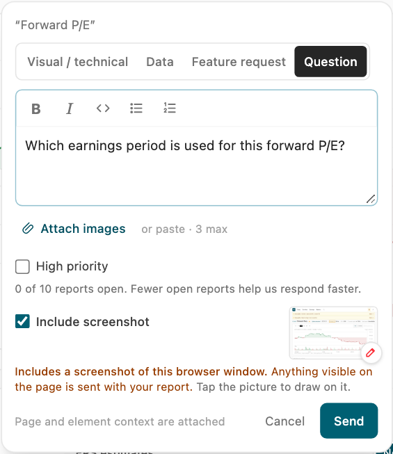

# Where does a valuation come from?

In August 2026, Coherent reported two earnings figures for the same quarter. Both came from the company. If I put one into a valuation, I want to be able to come back a year later and see which one I used and why. I built a private investment portal so I could go back and check. Here’s how I read one company in the October 2026 snapshot.

Open the market overview from that session

## What did the company actually earn?

Coherent reported **$1.19 in GAAP diluted earnings per share** for its fiscal fourth quarter and **$1.74 on its own adjusted basis**. That’s a 46% difference in the denominator of a price-to-earnings ratio. The portal keeps both figures side by side. Opening the info button for that quarter shows what Coherent adjusted, including share-based compensation and amortization of acquired intangibles. You can check both numbers in the [original earnings release](https://ir.coherent.com/news-releases/news-release-details/coherent-corp-reports-fourth-quarter-and-full-year-fiscal-2026).

## What did analysts expect?

The same **$1.74** appears at the right of the earnings chart, **8% above the TipRanks consensus** for that quarter. Each dot is a reported result as recorded by the provider. The short horizontal line is the consensus estimate, and the shaded bar spans the low and high estimates. The last column is still open. It shows what analysts expected before the next result arrived.

Share-price targets have their own history. On 24 October, the portal had **511 ratings from 31 analysts** for Coherent, including **471 price targets** plotted below. Keeping the individual observations lets me ask what the consensus was at an earlier date and how widely analysts disagreed.

## Where does consensus end and my model begin?

The blue line in the lower chart is Coherent’s share price. The corridor shows what the next four quarters of earnings would be worth at the range of multiples investors paid over the selected 90 days. To extend that corridor a year into the future, I need earnings estimates for quarters further out.

**What this corridor rests on** shows the handoff quarter by quarter. On 26 October, Yahoo Finance’s FY2027 revenue consensus was **$10.6 billion from 21 analysts**. Where only an annual estimate was available, the model allocated it across quarters using the prior year’s seasonal pattern. Beyond FY2028, I assumed revenue would keep growing at 38% and capped earnings growth at that same rate. In this snapshot, **23% of the earnings behind the 12-month target depended on that extension**. That’s the assumption I’d revisit first.

## Does management tend to guide low?

Coherent publishes an outlook in its earnings release. Microsoft gives its outlook on the earnings call, so I use Microsoft’s official transcript. The portal keeps management’s wording and the source line, then compares the next reported result with the bottom, midpoint and top of the range management gave.

In Microsoft’s history below, revenue repeatedly came in above the **top** of its guided range. The portal labels that pattern **“Sandbags”** when it happens in at least six of the last eight scored quarters. I can inspect the size of each beat myself. Across those same calls, cost of revenue was mixed and operating expenses regularly came in under budget.

## How do I challenge a number?

Select a figure such as **Forward P/E** and ask which earnings period it uses. The report carries the selected element, page and chart settings, so the person answering can see exactly what prompted the question. For a visual issue, the reader can mark up a screenshot and follow the reply in **Your reports**.

| Flagging overlapping chart labels | Asking which earnings period a multiple uses |
| --- | --- |
|  |  |
