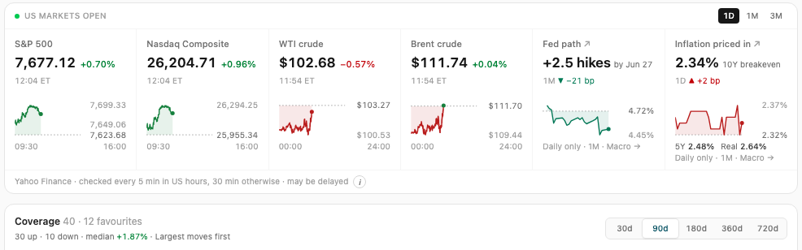
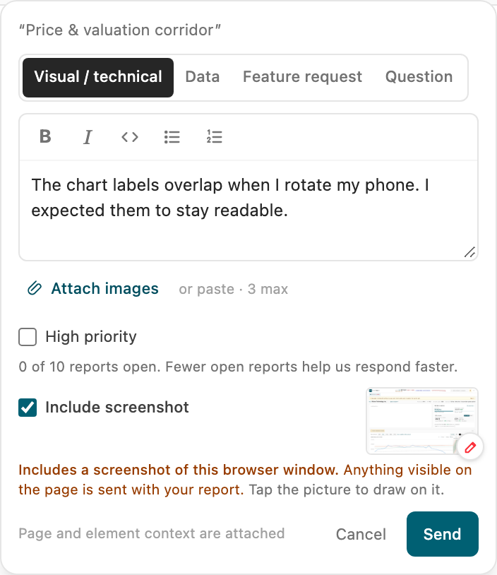

# Inside my investment portal

If a valuation changes after an earnings release, I want to know what moved. Did the company report a different number? Did analysts revise their estimates? Or did I change a rule in the model? I’m building a closed-source investment portal so I can follow each of those threads.

## Where the valuation comes from

Here’s Coherent on 26 October 2026. The blue line follows the share price. The shaded corridor shows what the next twelve months of estimated earnings would be worth at the multiples investors paid over the selected 90 days.

Reported figures point back to company filings. Analyst estimates carry a provider and a date. When those estimates run out, the portal shows the rule I used to project the remaining quarters. It saves the inputs with each projection, so I can revisit what the model assumed once the actual results arrive.

## Reporting an issue where you see it

A reader can select “Forward P/E” and ask which earnings period it uses, or flag overlapping labels on the chart itself. The report carries the selected element, page and chart settings. The reader can annotate an optional screenshot and follow the reply in **Your reports**.

| Reporting a chart issue | Asking about a model input |
| --- | --- |
|  |  |
